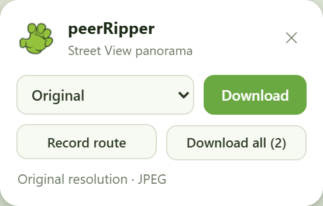
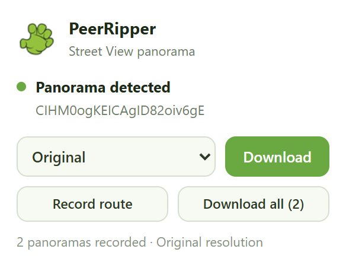

# peerRipper

**Download Google Street View panoramas as single, full-resolution JPEGs — stitched locally in your browser.**

[](LICENSE)
[](https://github.com/november-saiful/peerRipper/releases/latest)

peerRipper is a cross-browser extension for **Chrome, Edge, Opera, and Firefox**. When you are looking at a panorama in Google Maps Street View, it fetches the same 512 × 512 JPEG tiles Street View uses, works out the panorama's real tile canvas (for example 10240 × 5120), and splices those tiles into one file at the JPEG coefficient level. There is no server, no screenshotting, and no pixel re-encoding.

It can also record a route while you move through Street View and download every panorama you visited in one batch.

<p align="center">
  
  
</p>

---

## Contents

- [Features](#features)
- [Supported browsers](#supported-browsers)
- [Installation](#installation)
- [Usage](#usage)
- [How it works](#how-it-works)
- [Project structure](#project-structure)
- [Development](#development)
- [Permissions and privacy](#permissions-and-privacy)
- [Limitations](#limitations)
- [FAQ](#faq)
- [Contributing](#contributing)
- [License](#license)

## Features

- **True full resolution.** peerRipper probes the tile service to find the exact panorama canvas Google serves, instead of trusting the size hint in the URL. Original resolution can be 10240 × 5120 or larger.
- **Quality-preserving stitching.** Tiles are merged in the JPEG DCT domain. The image is never decoded to pixels and re-compressed, so the output retains the source tiles' quality and has no visible seams.
- **Three resolutions.** Original (native tile resolution), Half, and Quarter for smaller files.
- **Route recording.** Record the panoramas you visit while moving along a road or path, then download the whole route in one go. Up to 500 panoramas per route.
- **Works across browsers.** One shared engine, with a Chromium build and a Firefox build generated from the same source.
- **Local and private.** No account, no analytics, no backend. The only network requests are for Street View tiles from Google.
- **Resilient downloads.** Transient tile errors are retried with backoff; panoramas that are not served as Street View tiles are reported and skipped in batch mode.
- **Non-intrusive UI.** A small "Download panorama" pill and card rendered in a Shadow DOM, so Maps styles cannot break it and it cannot break Maps.

## Supported browsers

| Browser | Minimum version | Package |
| --- | --- | --- |
| Google Chrome | 116 | [`peerripper-chromium.zip`](https://github.com/november-saiful/peerRipper/releases/latest/download/peerripper-chromium.zip) |
| Microsoft Edge | 116 | [`peerripper-edge.zip`](https://github.com/november-saiful/peerRipper/releases/latest/download/peerripper-edge.zip) |
| Opera | Chromium 116+ | [`peerripper-opera.zip`](https://github.com/november-saiful/peerRipper/releases/latest/download/peerripper-opera.zip) |
| Mozilla Firefox | 140 (desktop), 142 (Android) | [`peerripper-firefox.zip`](https://github.com/november-saiful/peerRipper/releases/latest/download/peerripper-firefox.zip) |

The Chromium builds use an MV3 service worker with an offscreen document for blob handling. The Firefox build uses an MV3 event page and runs the engine directly in the background page.

> peerRipper is not yet listed in the browser add-on stores, so packages are distributed through [GitHub Releases](https://github.com/november-saiful/peerRipper/releases). The same ZIPs are ready to upload when submitting to a store.

## Installation

### 1. Get the extension package

**Option A — download a release (no build tools needed).** Download the ZIP for your browser from the [latest release](https://github.com/november-saiful/peerRipper/releases/latest) and extract it. The extracted folder contains `manifest.json` and the extension files.

**Option B — build from source.** You only need Node.js 22.2+ (or 20.15+). The packager has no npm dependencies.

```bash
git clone https://github.com/november-saiful/peerRipper.git
cd peerRipper
node tools/build.mjs
```

This creates four unpacked builds and four store-ready archives:

```
dist/chromium/            dist/peerripper-chromium.zip
dist/edge/                dist/peerripper-edge.zip
dist/opera/               dist/peerripper-opera.zip
dist/firefox/             dist/peerripper-firefox.zip
```

### 2. Load the extension

**Chrome**

1. Open `chrome://extensions`.
2. Enable **Developer mode**.
3. Click **Load unpacked** and select the extracted folder (or `dist/chromium` if you built from source).

**Edge**

1. Open `edge://extensions`.
2. Enable **Developer mode**.
3. Click **Load unpacked** and select the extracted folder (or `dist/edge` if you built from source).

**Opera**

1. Open `opera://extensions`.
2. Enable **Developer mode**.
3. Click **Load unpacked** and select the extracted folder (or `dist/opera` if you built from source).

**Firefox**

1. Open `about:debugging#/runtime/this-firefox`.
2. Click **Load Temporary Add-on…** and choose `manifest.json` inside the extracted folder (or `dist/firefox/manifest.json` if you built from source).

A temporary add-on is removed when Firefox restarts. For a permanent installation, the package must be signed by Mozilla (for example through [addons.mozilla.org](https://addons.mozilla.org/developers/)). The Firefox manifest already contains the Gecko ID `peerripper@peerripper.dev` and declares that no data is collected.

## Usage

### Download one panorama

1. Open Google Maps and enter **Street View**. The page URL should contain a panorama ID (`!1s<panoid>…`); share links work well.
2. Click the **Download panorama** pill in the bottom-right corner, or open the toolbar popup.
3. Choose a resolution:
   - **Original** — full native tile resolution.
   - **Half** — half width and height.
   - **Quarter** — quarter width and height.
4. Click **Download** and keep the tab open until it finishes.

The file is saved to your browser's Downloads folder as:

```
streetview_<panoid>_<width>x<height>.jpg
```

You can cancel at any time with the **Cancel** button. The extension shows the detected dimensions, tile count, and stitching/saving phases as it works.

### Record and download a route

1. Open a panorama and click the pill to open the card (or use the popup).
2. Click **Record route**. The button turns red and the current panorama is added.
3. Move through Street View along the road — use the navigation arrows, drag the view, or click further down the street. Every new panorama you enter while recording is captured once.
4. Click **Stop recording** when done.
5. Pick a resolution and click **Download all (N)**.

Batch files are saved to a subfolder and numbered in capture order:

```
Downloads/peerRipper/001_<panoid>_<width>x<height>.jpg
Downloads/peerRipper/002_<panoid>_<width>x<height>.jpg
…
```

The recorded route lives in the tab's `sessionStorage`, so it survives page reloads in that tab but disappears when the tab is closed. A route holds at most 500 panoramas; when the limit is reached, recording stops automatically.

## How it works

### Discovery

The content script finds the panorama ID in the page URL (`!1s…`) or, as a fallback, in recent Street View tile requests. The `!7i…!8i…` values in Maps URLs are treated only as a size hint — they describe the source photo and can be smaller than the actual tile canvas.

### Probing the canvas

At maximum tile zoom, the engine binary-searches the last valid tile index on each axis. A tile counts as valid only when it returns a JPEG with three color components, which filters out Google's grayscale "unavailable" placeholder. The panorama canvas is then derived from the last valid tile:

```
width  = (lastX + 1) × 512
height = (lastY + 1) × 512
```

Lower resolutions request the correspondingly lower tile zoom, so Half and Quarter are natively smaller images rather than downscaled copies.

### Fetching and stitching

- Tiles are downloaded with a concurrency of 8.
- HTTP 408, 429, 500, 502, 503, and 504 responses are retried with backoff.
- HTTP 400/404 means the panorama is not available through the web tile service (common for photo spheres and some user uploads).
- [`stitcher.js`](extension/stitcher.js) parses the baseline 4:2:0 JPEG tiles, reads their quantized DCT coefficients, merges everything into one scan, and writes a new JPEG. If a tile uses different quantization tables, its coefficients are re-quantized onto the panorama-wide (element-wise minimum) table. Pixels are never decoded or re-encoded.

### Per-browser plumbing

```
Google Maps tab
┌───────────────────────────┐    messages    ┌──────────────────────────┐
│ api.js + content.js       │ ─────────────► │ background-core.js       │
│ panoid discovery, UI,     │ ◄───────────── │ job state, progress,     │
│ route recorder            │                │ downloads API            │
└───────────────────────────┘                └────────────┬─────────────┘
                                                          │
                              Chromium: offscreen document │ Firefox: background page
                                                          ▼
                                             engine.js + stitcher.js
                                             probe → fetch tiles → stitch → save
```

- `api.js` exposes `peerRipperApi`, which prefers the promise-based `browser.*` namespace and falls back to `chrome.*`.
- `background-core.js` is browser-neutral: it owns job state, relays progress to the tab, and performs downloads.
- On Chromium, `bridge-chromium.js` forwards work to an offscreen document (`offscreen.html`) that can create Blob URLs; `downloads.onDeterminingFilename` restores the intended filename for blob downloads.
- On Firefox, `bridge-firefox.js` calls the engine inline in the background page.

## Project structure

```
extension/                 Shared source for every browser
  manifest.base.json       Common manifest (v1.2.0)
  manifest.chromium.json   Chromium patch: service worker + offscreen permission
  manifest.firefox.json    Firefox patch: background scripts + Gecko metadata
  api.js                   browser.*/chrome.* API shim
  content.js               In-page pill/card, panoid discovery, route recorder
  popup.html / popup.js    Toolbar popup
  background.js            Chromium service-worker entry point
  background-core.js       Job orchestration and download handling
  bridge-chromium.js       Offscreen document bridge (Chromium)
  bridge-firefox.js        Inline engine bridge (Firefox)
  engine.js                Tile probe, fetch, and download pipeline
  stitcher.js              DCT-domain JPEG stitcher
  offscreen.html / .js     Blob host for Chromium
  icons/                   Extension icons
tools/build.mjs            Zero-dependency build and ZIP packager
test/
  e2e.mjs                  Playwright end-to-end test (Chromium builds)
  firefox-background.mjs   Firefox background path test in a Node VM
docs/screenshots/          README images
```

## Development

### Build

```bash
node tools/build.mjs
```

`dist/` is generated and intentionally ignored by git. The build merges the base manifest with each browser patch, copies only the files that browser needs, and writes a store-only ZIP using `node:zlib` — no bundler and no dependencies.

### Tests

```bash
cd test
npm install
npm test                  # Chromium end-to-end test
npm run test:firefox      # Firefox background path
PEERRIPPER_TARGET=edge npm test
```

- The end-to-end test launches Chromium with the built extension, serves a mocked Maps page, downloads a real panorama (half resolution), verifies the JPEG dimensions and filename, then records a two-panorama route and checks that batch downloading saves one file and skips an unavailable panorama.
- The test makes live requests to Google's tile service, so it needs internet access and downloads roughly 3 MB. It cleans up its test downloads and profile afterwards.
- `PEERRIPPER_TARGET` selects any built Chromium-family folder (`chromium`, `edge`, or `opera`).
- The Firefox test loads `dist/firefox` scripts in a Node `vm` with a mocked `browser` API, verifying the background job and batch flow without a browser.

Optional Firefox lint:

```bash
npx web-ext lint --source-dir dist/firefox
```

## Permissions and privacy

| Permission | Why it is needed |
| --- | --- |
| `downloads` | Save the stitched JPEG (and batch files) to the Downloads folder. |
| `storage` | Keep temporary job/progress state in session storage. |
| `scripting` + `activeTab` | Inject the content script from the popup when Maps was opened before the extension was installed or reloaded. |
| `https://streetviewpixels-pa.googleapis.com/*` | Fetch Street View image tiles. |
| Content script matches on Google Maps domains | Show the in-page pill and read the current panorama ID. |

peerRipper has **no analytics, telemetry, accounts, remote code, or backend**. The only outbound traffic is tile requests to Google. Recorded routes are stored in the Maps tab's `sessionStorage` and are never synced anywhere.

## Limitations

- **Street View tiles only.** Photo spheres, some user-contributed uploads, and panoramas that are not served through the web tile service return HTTP 400/404 and cannot be downloaded this way. In batch mode they are skipped and reported.
- **A panorama must be open.** peerRipper reads the live panorama from the Maps tab; it does not accept bare place links or arbitrary coordinates.
- **Route capture follows your navigation.** Only panoramas you actually enter while recording are added. Panoramas that the page skips over are not captured.
- **Resolution is discovered by probing.** Unusual panoramas may report a canvas different from the `!7i/!8i` hint, which is expected.
- **Firefox temporary installs do not survive restart.** Permanent installation requires a signed build.
- **Street View changes.** Google can change how Maps embeds panoramas or serves tiles; discovery may need updating when that happens.
- **Use responsibly.** Download only imagery you are entitled to use, and respect Google's Terms of Service and applicable copyright. peerRipper is not affiliated with, endorsed by, or sponsored by Google. Google Maps and Street View are trademarks of Google LLC.

## FAQ

**Does peerRipper upload or collect anything?**
No. Everything runs in your browser, and no usage data leaves it.

**Why does a panorama fail with "not served as Street View tiles"?**
That panorama is probably a photo sphere or a user upload. Google does not expose it through the same tile endpoint, so there is nothing to stitch.

**Why is the file so large?**
Original resolution is the raw panorama (often 10240 × 5120). Choose Half or Quarter if you need a smaller file.

**Is the output a screenshot?**
No. It is assembled from the source JPEG tiles at the coefficient level, so it keeps the source detail rather than capturing the distorted, partially loaded canvas.

**Where do batch files go?**
To a `peerRipper` folder inside your Downloads folder, numbered in the order they were recorded.

## Contributing

Issues and pull requests are welcome. Before submitting a change:

1. Run `node tools/build.mjs`.
2. Run `npm test` and `npm run test:firefox` from `test/`.
3. Keep the Chromium and Firefox builds working from the shared source — browser-specific behavior belongs in the bridges or manifest patches, not in the shared engine.

## License

[MIT](LICENSE) © 2026 peerRipper contributors
